# AuditLens

**Slither finds the bugs. Gemma 4 explains them. Code verifies everything.**

An AI-assisted smart contract auditor for Solidity (and Soroban). It runs a static analyzer, sends the findings and the whole codebase to Gemma 4 (long context) for triage and plain-English explanations, then checks every AI claim against the real source code. Claims that can't be verified are removed and listed.

> Automated first-pass review. Not a substitute for a professional audit.

## Demo

[▶ Watch the demo video](docs/AuditLens_Film.mp4) (MP4, 6 MB)

---

## Quick start (local)

**Requirements:** Node 22+ and Python 3.10+.

```bash
# 1. Install the app
npm install

# 2. Create and activate a Python virtual environment (recommended)
python -m venv .venv
# Windows PowerShell:
.\.venv\Scripts\Activate.ps1
# macOS/Linux:
# source .venv/bin/activate

# 3. Install Slither + solc-select from the requirements file
python -m pip install -r requirements.txt
solc-select install 0.8.20
solc-select use 0.8.20

# 4. Optional: Foundry, so exploit tests actually run
#    https://getfoundry.sh  (curl -L https://foundry.paradigm.xyz | bash && foundryup)

# 5. Configure the LLM
cp .env.example .env      # Windows: copy .env.example .env
#    then fill in JARVIS_API_KEY, JARVIS_BASE_URL, GEMMA_MODEL (or use local mode, below)

# 6. Run
npm run dev               # open http://localhost:3000
```

Click **Try sample** to audit `samples/VulnerableVault.sol`, which contains 5 deliberate bugs.

### Run without the UI

```bash
npm run audit -- samples                    # summary + grade in the terminal
npm run audit -- samples --md               # full Markdown report
npm run audit -- path/to/repo --diff main   # diff mode: only functions changed since main
npm run benchmark                           # precision/recall vs Slither alone
```

## Run with Docker

```bash
cp .env.example .env   # fill in the API values
docker compose up --build
```
The image includes Slither, solc 0.8.20 and Foundry. Add `--build-arg INSTALL_SCOUT=true` for Soroban/Scout support (large). Reports are saved to `./reports`.

---

## Features

### On the report page
| Feature | What it does | What keeps it honest |
|---|---|---|
| **Risk grade** | One grade A–F from the severity counts, at the top of the report. **Copy README badge** gives a shields-style SVG (`/api/report/<id>/badge`). | Any critical → F. Any high → D at best. |
| **Code view** | Click a location or quoted line to open the whole file, with the line highlighted and the lines around it shaded. Dots mark every finding in the file. | Shows the stored source, not model output. |
| **Explain like I'm new** | Toggle a simpler explanation per finding, with a link to its SWC Registry entry. | SWC IDs from the model are checked against the registry list in `lib/swc.ts`. Unknown IDs are discarded. |
| **Attack scenario** | Step-by-step attack story for high and critical findings. | Only kept for high/critical findings that passed the quote check. |
| **Fix it** | Gemma writes a patch, shown as a before/after diff. | Code applies the patch, then compiles it with solc-js. Shows **✓ compiles** only if it does. If the *original* doesn't compile here (e.g. missing OpenZeppelin imports), it says the check is unavailable instead of failing the fix. |
| **Apply + Re-audit** | Apply fixes, re-run the whole audit on the patched code, and get *"High: 2 → 0. Fixed: Reentrancy. New: none."* | The comparison is computed by code (matched on file + issue type + code line). |
| **Prove it (exploit test)** | Gemma writes a Foundry test for the bug, and AuditLens runs `forge test`. | **Exploit confirmed** only if the test *passes* against the original code. If a fix is applied, the same test is re-run to show the fix blocks it. Without Foundry the test is shown but marked "not run". |
| **Contract map** | Contracts, functions, who can call them (anyone / restricted / tx.origin / internal), which send ETH, make external calls or delegatecall, with internal call arrows. Risky functions are highlighted. | Built by parsing the source, so it works even when Slither can't compile the project. |
| **Ask about the code** | Chat box: "Can anyone drain funds?", "Who can call execute()?" | Every cited line goes through the same quote check. Unverified citations are struck through and flagged. |

### Other ways in
- **Deployed contracts.** Pick a chain, paste an address. AuditLens fetches the verified source from Sourcify (no key needed) or Etherscan (set `ETHERSCAN_API_KEY`) and audits it.
- **Soroban.** Rust projects (no `.sol` files) are detected automatically. Scout (`cargo install cargo-scout-audit`) is used as the analyzer if installed. Otherwise it's an AI-only review. Try **Soroban sample**.
- **Local mode.** `LLM_PROVIDER=ollama` runs Gemma 4 through Ollama, so code never leaves the machine. AuditLens uses Ollama's native API so it can set `num_ctx`; the OpenAI-compatible endpoint silently truncates long prompts.

### History and benchmark
- **History** (`/history`) lists every audit with its grade and severity counts, plus a risk-score trend per project. It's indexed in SQLite (Node's built-in `node:sqlite`, no native build). The JSON reports stay the source of truth, and the index rebuilds itself if deleted.
- **Benchmark** (`/benchmark`). `npm run benchmark` runs Slither alone and AuditLens on the labelled cases in `benchmark/cases` (plus a clean control contract) and scores both against `benchmark/labels.json`. The page shows the real results from `benchmark/results.json`, or nothing until you've run it.

### GitHub Action / PR bot
`action.yml` makes this repo a GitHub Action. On each pull request it:
1. finds the functions that changed against the base commit (**diff mode**, so it's faster and cheaper),
2. audits only those functions,
3. posts (and updates) one PR comment with the findings,
4. fails the check if a finding is at or above `fail-on` (default `high`). Make the check required to block the merge.

Copy `examples/auditlens-pr.yml` into your contracts repo's `.github/workflows/`.

---

## Audit workflow

1. **Provide a project.** Submit pasted Solidity, a ZIP, a public GitHub repository, a deployed contract address, or one of the bundled samples. The CLI can audit a local path; the GitHub Action audits functions changed in a pull request.
2. **Collect source.** AuditLens extracts or downloads the project when needed, collects Solidity or Rust source, skips common dependency/test/build directories, and detects Solidity versus Soroban. Deployed source is fetched from Sourcify or Etherscan.
3. **Run static analysis when available.** Solidity projects use Slither; Soroban projects use Scout when installed. If the analyzer is unavailable or cannot compile the code, the report warns that findings are AI-only. With no LLM configured, a working analyzer can still produce a tool-only report.
4. **Build model context.** The pipeline combines source with analyzer findings, prioritizes relevant files, numbers source lines, and applies the configured context budget. Diff mode limits this to changed functions.
5. **Review with the LLM when configured.** Gemma receives the context through an OpenAI-compatible endpoint or local Ollama and returns structured findings, explanations, and (where applicable) attack scenarios.
6. **Verify findings.** AuditLens checks file paths, quoted source, line numbers, analyzer attribution, and SWC identifiers; restores tool findings the model omitted; and records dropped claims and coverage warnings.
7. **Save and inspect the report.** The report is persisted as JSON, with a SQLite index for history. The report UI exposes findings and source; separate actions can generate/compile fixes, re-audit patched code, run Foundry exploit tests, answer questions with checked citations, or export Markdown.
8. **Apply CI policy when using the PR Action.** The action posts or updates a pull-request comment and fails the check when a finding meets the configured `fail-on` severity.

## Basic architecture

The Next.js app provides the UI and HTTP API. The CLI and GitHub Action are alternate entry points into the same audit pipeline. The pipeline delegates source collection, analyzers, model prompting, verification, and persistence to `lib/`; report-specific endpoints and components provide the follow-up views and actions.

```mermaid
flowchart LR
    User["User / GitHub PR"] --> Entry["Next.js UI and API"]
    User --> CLI["CLI"]
    User --> Action["GitHub Action"]
    Entry --> Pipeline["lib/pipeline.ts"]
    CLI --> Pipeline
    Action --> Diff["Changed-function detection"]
    Diff --> Pipeline
    Pipeline --> Ingest["Source collection"]
    Ingest --> Analyzer{"Analyzer available?"}
    Analyzer -->|Solidity| Slither["Slither"]
    Analyzer -->|Soroban| Scout["Scout"]
    Analyzer -->|No| Context["Context builder"]
    Slither --> Context
    Scout --> Context
    Context --> LLM{"LLM configured?"}
    LLM -->|Yes| Model["Gemma API or Ollama"]
    LLM -->|No| Verify["Finding verification"]
    Model --> Verify
    Verify --> Store["JSON report + SQLite history index"]
    Store --> Report["Report UI, API, CLI export, or PR comment"]
    Report --> Followups["Fix / re-audit / exploit test / Q&A"]
```



In the full mode, the analyzer findings ground the model review, and verification checks the resulting claims against collected source and tool output. Tool-only mode skips the model; AI-only mode runs when tool findings are unavailable. The report JSON is the source of truth, while the SQLite database is a rebuildable history index.

---

## Modes

| Analyzer | LLM configured | Mode | What you get |
|---|---|---|---|
| ✓ | ✓ | `full` | Tool findings triaged and explained by Gemma, plus verified AI extras |
| ✓ | ✗ (or `MOCK_LLM=true`) | `tool-only` | Raw analyzer findings, no AI. Fix / exploit / Q&A are disabled |
| ✗ | ✓ | `ai-only` | AI review only; every finding is labelled AI-suggested |

## How verification works (`lib/verify.ts`)

For every finding the model returns:
1. **File check.** The file must exist, otherwise the finding is dropped.
2. **Quote check.** The `code_quote` must appear in that file (whitespace-insensitive), otherwise the finding is dropped. If it's a real tool finding, it's kept with the tool's location instead.
3. **Line check.** The line number is corrected to where the quote actually is.
4. **Source check.** Anything claiming to be a Slither/Scout finding must match a real tool result, otherwise it's relabelled as AI.
5. **No hiding.** Every tool finding the model didn't address is added back as "needs review". The model can merge duplicates only by listing their Slither IDs, and those IDs are checked.
6. **Coverage.** Slither silently skips files it can't compile. AuditLens compares the files Slither compiled with the files it collected, and warns about any that were never analyzed.
7. **Severity.** If the model rates a tool finding 2+ levels higher than the tool did, the finding says so.

The same idea runs through the newer features: patches are compiled, exploits are run, Q&A citations are quote-checked, SWC IDs are looked up.

## Project files

This is a file-by-file guide to the source, configuration, examples, and assets in the repository. `.git` metadata and dependencies/build output are intentionally excluded.

### Application routes and pages

- `app/page.tsx` — Next.js entry page for submitting source, repositories, deployed addresses, and samples.
- `app/layout.tsx` — shared application layout and document metadata.
- `app/globals.css` — global styles and Tailwind layer imports.
- `app/report/[id]/page.tsx` — loads and renders an individual audit report.
- `app/history/page.tsx` — audit history and project risk-score trends.
- `app/benchmark/page.tsx` — displays benchmark results when available.
- `app/api/audit/route.ts` — accepts an audit request, runs the pipeline, and stores its report.
- `app/api/report/[id]/route.ts` — returns a report as JSON or Markdown.
- `app/api/report/[id]/file/route.ts` — returns a stored source file for the report code viewer.
- `app/api/report/[id]/finding/route.ts` — handles finding actions, including fix generation/application and exploit tests.
- `app/api/report/[id]/reaudit/route.ts` — audits patched source and compares the new findings with the original report.
- `app/api/report/[id]/ask/route.ts` — answers questions about a report with checked source citations.
- `app/api/report/[id]/badge/route.ts` — generates an SVG risk-grade badge for a report.

### UI components

- `components/HomeClient.tsx` — client-side interactions for the audit submission page.
- `components/Hero3D.tsx` — 3D hero visual used on the home page.
- `components/Motion.tsx` — shared animation and motion effects.
- `components/ReportClient.tsx` — client-side report state and finding actions.
- `components/ReportHeader.tsx` — report title and high-level report controls.
- `components/FindingList.tsx` — finding summaries, details, and per-finding actions.
- `components/CodeViewer.tsx` — source display with finding locations and highlighted lines.
- `components/ContractMap.tsx` — visual contract/function relationship map.
- `components/AskBox.tsx` — question input and verified-citation answer display.
- `components/RiskGrade.tsx` — risk grade and README badge controls.
- `components/SeverityBadge.tsx` — severity label styling.
- `components/SummaryBar.tsx` — aggregate finding counts by severity.
- `components/ComparisonBanner.tsx` — before/after audit comparison for re-audits.
- `components/TrendChart.tsx` — risk-score history chart.

### Audit and verification library

- `lib/types.ts` — shared TypeScript types for audit inputs, findings, and reports.
- `lib/ingest.ts` — collects Solidity/Rust source, assigns line numbers, unpacks archives, and downloads GitHub source.
- `lib/onchain.ts` — fetches verified deployed-contract source from Sourcify or Etherscan.
- `lib/slither.ts` — runs Slither and parses its JSON findings.
- `lib/scout.ts` — runs Scout and parses its SARIF findings for Soroban projects.
- `lib/context.ts` — selects and budgets source and findings for model prompts.
- `lib/prompt.ts` — defines model instructions and structured output schemas.
- `lib/gemma.ts` — calls OpenAI-compatible or Ollama model APIs, including retry and response parsing.
- `lib/verify.ts` — validates model findings and citations against collected source and analyzer results.
- `lib/pipeline.ts` — coordinates ingestion, analysis, model triage, verification, and report creation.
- `lib/fix.ts` — generates and applies source patches and produces diffs.
- `lib/compile.ts` — checks patched Solidity/Rust source with available compilers.
- `lib/exploit.ts` — generates Foundry exploit tests and runs them when Foundry is installed.
- `lib/ask.ts` — generates answers about report source and verifies their citations.
- `lib/compare.ts` — matches findings between the original and re-audited reports.
- `lib/contractmap.ts` — parses contracts and functions for the contract map and related analysis.
- `lib/diffmode.ts` — identifies functions changed between revisions or Git references.
- `lib/score.ts` — calculates risk grades and renders badge SVGs.
- `lib/swc.ts` — contains the recognized SWC Registry identifiers used to validate model output.
- `lib/benchmark.ts` — compares analyzer and AuditLens findings against benchmark labels.
- `lib/storage.ts` — saves JSON reports and maintains/rebuilds the SQLite history index.
- `lib/export.ts` — converts reports and comparisons into Markdown.
- `lib/highlight.ts` — source-code highlighting helpers used by the report viewer.

### Command-line and GitHub Action scripts

- `scripts/env.ts` — loads environment configuration for scripts.
- `scripts/audit.ts` — command-line audit entry point, including Markdown and diff modes.
- `scripts/benchmark.ts` — runs the labeled benchmark and writes its results.
- `scripts/ci.ts` — GitHub Action runner that audits changed functions, updates the PR comment, and applies the configured severity threshold.
- `action.yml` — composite GitHub Action definition, inputs, tool setup, and CI script invocation.
- `examples/auditlens-pr.yml` — example workflow showing how to run the action on contract pull requests.

### Benchmark cases and samples

- `benchmark/labels.json` — expected vulnerable lines and categories used to score benchmark runs.
- `benchmark/results.json` — saved benchmark scores displayed by the benchmark page; refreshed by `npm run benchmark`.
- `benchmark/cases/airdrop-dos/Airdrop.sol` — benchmark case for denial of service through a recipient loop.
- `benchmark/cases/reentrancy-bank/Bank.sol` — benchmark case for reentrancy during a withdrawal.
- `benchmark/cases/safe-vault/SafeVault.sol` — clean control contract used to measure false positives.
- `benchmark/cases/tx-origin-wallet/Wallet.sol` — benchmark case for using `tx.origin` as authorization.
- `benchmark/cases/unchecked-calls/Payout.sol` — benchmark case for ignored failure results from ETH calls.
- `benchmark/cases/unchecked-math/Points.sol` — benchmark case for unsafe points arithmetic.
- `benchmark/cases/unprotected-owner/Treasury.sol` — benchmark case for unprotected ownership and self-destruction.
- `benchmark/cases/user-delegatecall/Router.sol` — benchmark case for user-controlled `delegatecall`.
- `benchmark/cases/weak-lottery/Lottery.sol` — benchmark case for predictable randomness.
- `samples/VulnerableVault.sol` — Solidity demo contract with five deliberate vulnerabilities.
- `samples/soroban-vault/Cargo.toml` — Rust package manifest for the Soroban demo.
- `samples/soroban-vault/src/lib.rs` — Soroban vault demo contract.

### Deployment, configuration, and supporting files

- `Dockerfile` — builds the application container, including the configured audit tools.
- `docker-compose.yml` — runs the container on port 3000, loads `.env`, and persists reports.
- `.dockerignore` — excludes local dependencies, build output, reports, and secrets from the Docker build context.
- `.env.example` — template for model, local Ollama, context budget, analyzer-only mode, API key, and report-directory settings.
- `.gitignore` — excludes local secrets, dependencies, generated Next.js files, and report data from Git.
- `package.json` — project metadata, dependencies, and commands for development, build, audit, CI, benchmark, and type-checking.
- `package-lock.json` — exact npm dependency resolution used by `npm ci`.
- `requirements.txt` — Python packages for static analysis (`slither-analyzer`) and managing the Solidity compiler (`solc-select`).
- `next.config.mjs` — Next.js application configuration.
- `postcss.config.mjs` — PostCSS plugin configuration used by the CSS build.
- `tailwind.config.ts` — Tailwind content scanning and theme configuration.
- `tsconfig.json` — TypeScript compiler and module-resolution settings.
- `docs/AuditLens_Film.mp4` — short product demo linked from the README.
- `README.md` — setup instructions, feature overview, usage, and this file reference.

## Configuring the LLM

AuditLens calls `POST {JARVIS_BASE_URL}/chat/completions` in the OpenAI format with `response_format: json_object`. If the provider rejects `response_format`, it automatically retries without it. Any OpenAI-compatible host that serves Gemma 4 works. Check your provider's docs for the exact base URL and model name.

Gemma 4's "thinking" is turned off by default (`chat_template_kwargs.enable_thinking=false`). In testing on Jarvis Labs (`gemma-4-26b-a4b-it`), thinking-on requests ran out of tokens without answering in 3 of 4 runs, while thinking-off answered every time in about 10 seconds. Set `LLM_THINKING=true` to try it anyway. If a provider rejects the option, AuditLens retries without it.

For local mode, set `LLM_PROVIDER=ollama`, `OLLAMA_MODEL` (the tag you pulled) and optionally `OLLAMA_NUM_CTX` (default 32768). The code budget is reduced automatically to fit.
